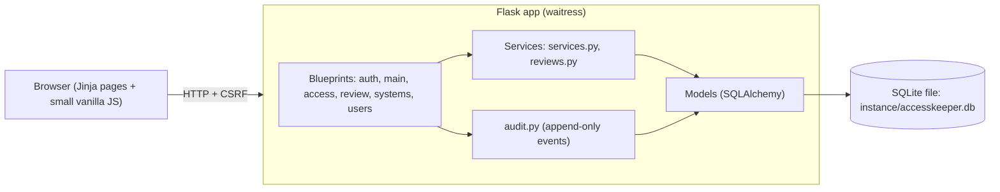

# AccessKeeper

[Português](README.pt-BR.md) · English

[](https://github.com/Vitorfab/AccessKeeper/actions/workflows/ci.yml)
[](https://github.com/Vitorfab/AccessKeeper/actions/workflows/codeql.yml)
[](LICENSE)

A small web app where identity administrators **manually register temporary privileged accesses they already granted**, track when they expire, and run periodic review campaigns.

> **Demo project, not for production use.** AccessKeeper only records and reminds. It does not revoke anything in Entra ID, FortiGate or any other system, and it must never be used to store passwords or secrets.

## What it is

Typical records: an Entra ID role given to an existing account, a guest invited to manage a domain for a few weeks, temporary FortiGate admin rights for three weeks. Someone has to remember to take those back. AccessKeeper keeps the list, shows what is about to expire, and makes the review of expired accesses a visible, auditable routine.

There is no request or approval workflow, no integration with Microsoft Graph, SSO or any external service, and no email. Alerts are visual, on the dashboard.

## Features

- **Access register**: name, email, company, internal/external, access type, system/target (picked from a catalog), description, justification, authorized by, optional ticket, start and end date and time, notes. Free text with autocomplete from values already registered.
- **Criticality** (Standard, High or Critical), chosen by whoever registers the access. It shows as a badge, can be filtered and sorted, appears in the CSV, can scope a review campaign, and the dashboard counts the High and Critical accesses that are running.
- **Duration shortcuts** (4h, 8h, 24h, 7d, 14d, 30d, 90d) or a custom end date. Warnings (never blocks) appear above 1 year, for Critical accesses above 30 days and for High ones above 90 days (`CRITICAL_MAX_DAYS`, `HIGH_MAX_DAYS`).
- **Automatic status**: Scheduled (start date in the future), Active, Expiring soon (14 days by default) and Expired. **Closed** is set by hand, with a reason, or by a confirmed removal in a review.
- **Renew** an access with a reason. Every previous end date stays in the history.
- **Records are never deleted.** Closed accesses become read-only and cannot be renewed. To grant the same access again, use **Register again**, which opens the new-access form prefilled and creates a new record.
- **Systems catalog**: the System / target field is a list (Firewall, Web application firewall, Cloud provider, Microsoft 365 and so on) that any administrator can extend or disable under **Systems**. Systems are never deleted. The access type stays free text.
- **Review queue**: expired accesses stay in a permanent queue until someone records what happened.
- **Review campaigns**: name, start date, due date and a scope (status, internal/external, criticality, company, system). The matching accesses are copied into the campaign and each gets an outcome: *Removal confirmed*, *Renewed* or *Kept with justification*. Progress (for example 8 of 12) and the overdue state are shown.
- **Bulk review**: tick several pending items of a campaign and record one outcome for all of them. Every item is checked first; if one fails nothing changes and each problem is listed. *Removal confirmed* asks for a confirmation screen because it cannot be undone.
- **Campaign report**: a printable page and a CSV with the scope, dates, totals per outcome and every item with its outcome, justification, reviewer and date. Available to administrators and viewers.
- **Edit history**: every edit keeps the previous and the new value of each changed field, with who and when. It cannot be changed or deleted.
- **Expiring summary**: a printable page with the accesses ending soon and the expired ones still awaiting review. Available to administrators and viewers.
- **Archive**: closed accesses, kept out of the main list but always searchable.
- **Automatic sign-out after 5 idle minutes** (configurable). A notice appears 30 seconds before: move the mouse, click or type to stay signed in.
- **Audit log** (admin only): append-only, filterable, exportable to CSV. New events are sealed in a **hash chain**, and the **Verify integrity** screen checks it.
- **Users and roles**: `admin` and `viewer` (read-only), plus a protected **master** administrator.
- **CSV export** of accesses and of the audit log, protected against spreadsheet formula injection.
- Dark theme, all assets local (no CDN, no tracking), works offline.

## Screenshots

_Add your screenshots here._

## Architecture



## Run on Windows (recommended)

1. Install Python 3.12 or newer from <https://www.python.org/downloads/> and tick **Add python.exe to PATH**.
2. Download or clone this project and open its folder.
3. Double-click **`run.bat`**.

On the first run it creates the virtual environment, installs the dependencies, generates a random `SECRET_KEY` in `.env`, starts the app and opens the browser at <http://127.0.0.1:5000>. The first screen asks you to create the **master administrator**. There is no default user or password.

To stop the app, close the window or press `Ctrl+C`.

## Run manually

```bash
python -m venv .venv
.venv\Scripts\activate          # Linux/macOS: source .venv/bin/activate
pip install -r requirements.txt
python init_env.py               # creates .env with a random SECRET_KEY
python wsgi.py
```

## Run with Docker (optional)

```bash
python init_env.py               # or create .env by hand with SECRET_KEY=<long random value>
docker compose up --build
```

The app listens only on `127.0.0.1:5000`. Data lives in the `accesskeeper-data` volume. Reset the master password inside the container with:

```bash
docker compose exec accesskeeper python reset_master.py
```

## Configuration (`.env`)

Copy `.env.example` to `.env` (`run.bat` does it for you). The main settings:

| Variable | Default | Meaning |
|---|---|---|
| `SECRET_KEY` | generated | Required. Never commit `.env`. |
| `TIMEZONE` | `America/Sao_Paulo` | Display timezone. Data is always stored in UTC. |
| `EXPIRING_DAYS` | `14` | Window for "Expiring soon". |
| `CRITICAL_MAX_DAYS` / `HIGH_MAX_DAYS` | `30` / `90` | Longer Critical or High accesses show a warning (never a block). |
| `AUDIT_HASH_KEY` | empty | Optional separate key (32+ characters) for the audit hash chain. Empty means it is derived from `SECRET_KEY`. |
| `CSV_DELIMITER` | `,` | Use `;` if Excel puts each row in one column. |
| `MIN_PASSWORD_LENGTH` | `12` | Minimum password length. |
| `MAX_LOGIN_ATTEMPTS` / `LOCKOUT_MINUTES` | `5` / `15` | Login lockout. |
| `IDLE_TIMEOUT_MINUTES` | `5` | Sign out after this many minutes without activity. |
| `COOKIE_SECURE` | `false` | Set `true` only behind HTTPS. |

## Users, roles and the master administrator

- **viewer**: can read everything except the audit log and users. Cannot create, edit, renew, close or review.
- **admin**: full access to the register and reviews. Can create and manage **viewers**.
- **master**: the first administrator, created on the setup page. Only the master can create administrators, change roles of administrators, or disable or reset them. Nobody can demote, disable or reset the master from the screen, and every attempt is recorded in the audit log as `user.action_denied`.

If the master password is lost, run `reset_master.bat` (or `python reset_master.py`) **on the machine where the app runs**. It asks for a new password in the terminal, unlocks the account and records the event. Anyone with access to the machine already controls the database file, so this opens no new door.

## How reviews work

- Expired accesses appear in the **review queue** until reviewed. Renewing an access also removes it from the queue. In the queue, *Kept with justification* leaves the access in the main list as an expired exception.
- In a **campaign**, record one outcome per item:
  - *Removal confirmed*: you checked that the access is gone. The record is marked **Closed** automatically (running or expired), becomes read-only and leaves the queue and future campaigns.
  - *Renewed*: renew the access first, then record the outcome.
  - *Kept with justification*: the justification is required.
- A recorded outcome is final (also enforced by a database trigger).
- A campaign can be closed at any time, even with pending items; the audit log keeps how many were reviewed.

## Audit log integrity

Every new audit event stores the hash of the event before it, plus its own hash: HMAC-SHA256 over the event data and the previous hash, with a key derived (HKDF) from `SECRET_KEY`, or from `AUDIT_HASH_KEY` if you set one. Changing, removing or inserting an event breaks the chain.

- Open **Audit log → Verify integrity** and press **Verify integrity**. It walks the whole chain and answers OK or names the first broken event. Each check is recorded as `audit.integrity_checked`.
- Events recorded **before** the chain existed (older versions) are never rewritten. When you upgrade, the app writes a start event with their count and a SHA-256 fingerprint, so changing them later is still detected. They show as "before the chain".
- The screen shows the **top of the chain** (the last hash, with its event number and time). Copy it somewhere outside the app now and then, for example in a ticket or email.
- **Keep your `.env` together with the database backup.** The chain key comes from it. If `SECRET_KEY` (or `AUDIT_HASH_KEY`) changes, the check says it cannot verify instead of accusing tampering.
- The audit CSV includes the previous hash and the hash of every event.
- **Verify without the app:** `verify_audit.bat` (or `python verify_audit.py`) checks the database file directly, read-only, using only the Python standard library. It exits with 0 (intact), 1 (tampering found) or 2 (could not verify), so it also works in scheduled jobs. Add `--top <hash>` to compare with the top of the chain you copied earlier, and `--db <file>` for another database. In Docker: `docker compose exec accesskeeper python verify_audit.py`.
- The dashboard reminds administrators when the log was not verified for `INTEGRITY_REMINDER_DAYS` days (default 30, `0` turns it off).

## Database backup

AccessKeeper uses one SQLite file: `instance/accesskeeper.db` (in Docker, inside the `accesskeeper-data` volume). To back it up, stop the app and copy that file somewhere safe, **together with your `.env`**. To restore, stop the app and put both files back. Treat the backup as sensitive: it contains the access register and the audit log.

## Upgrading from an earlier version

Replace the project files and keep your `instance/` folder and `.env`. On the first start the app adds the new tables and columns by itself and keeps your data. From 3.2 to 3.3: a table for the edit history is added; nothing else changes. From 3.1 to 3.2: every existing access becomes **Standard**, and the audit hash chain starts (a start event records how many older events exist and their fingerprint). You do not have to delete or change anything. Optionally add `CRITICAL_MAX_DAYS`, `HIGH_MAX_DAYS` and `AUDIT_HASH_KEY` to your `.env`; the defaults work. Earlier upgrades (3.0 to 3.1) also built the systems catalog and closed accesses already reviewed as removed. The old `SESSION_MINUTES` setting is no longer used: `IDLE_TIMEOUT_MINUTES=5` is the default.

## Tests

```bash
pip install -r requirements-dev.txt
python -m pytest
```

## Threat model and limitations

**What the app protects**

- Passwords are hashed (scrypt). Sessions use HttpOnly, SameSite=Lax cookies and expire after inactivity.
- CSRF protection on every form, server-side permission checks on every route, parameterized queries, escaped output.
- Login lockout and a generic login error, so accounts cannot be enumerated.
- Idle sign-out: the server stops accepting a session about 20 seconds after the idle limit, and the browser signs out exactly at the limit. The warning is a convenience, not a security control.
- The typed username of a failed login is **never** written to the audit log, because people sometimes type a password in that field. The log keeps `anonymous`, the reason and the IP.
- Content Security Policy without external sources, plus `X-Content-Type-Options`, `X-Frame-Options`, `Referrer-Policy` and related headers.
- CSV exports neutralize cells that start with `=`, `+`, `-` or `@`.
- The audit log, renewal history and recorded review outcomes cannot be edited or deleted from the app, and SQLite triggers block it at the database level.
- The audit log is also sealed in a keyed hash chain, so changes made directly in the database are detected by **Verify integrity**.

**What it does not protect**

- It is a **local, single-machine demo**. There is no TLS by itself and no multi-instance support. Do not expose it to a network.
- It **does not revoke anything** in any real system. Someone must do that.
- Anyone with access to the machine or the `.env` and database files has full control. The database is not encrypted.
- Free-text fields can still receive a secret if a person types one. The screens warn "Do not store passwords or secrets", but the app cannot detect it.
- No two-factor authentication and no SSO.
- Until the first administrator is created, the setup page is open to whoever reaches the app first. Create the administrator right after the first start, and keep the app on `127.0.0.1`.
- The login lockout is per account, so someone could deliberately lock a user out for a few minutes.
- The audit log is tamper-resistant from the app, not tamper-proof: a person with direct database access can drop the triggers. The hash chain detects such changes **unless the person also has the key**: someone who holds both the database and `SECRET_KEY` (or `AUDIT_HASH_KEY`) can recompute the whole chain.
- The verification alone cannot notice that the **last** events were deleted along with the chain head. Copy the top-of-chain hash outside the app from time to time: a later check that does not match it reveals a cut or a rebuilt chain.
- If the chain key is lost or changed, the log still works, but its integrity can no longer be verified.

## Project structure

```
accesskeeper/
  __init__.py        app factory, security headers, error pages
  config.py          settings from .env
  models.py          tables, statuses, database triggers
  services.py        filters, status queries, CSV builders
  reviews.py         queue, campaign, bulk review and report rules
  migrations.py      startup upgrades (new columns, hash chain start, systems catalog, closing removed accesses)
  audit.py           append-only event recorder
  integrity.py       audit hash chain: sealing, key derivation, verification
  forms.py           validation
  blueprints/        auth, main, access, review, systems, users
  templates/ static/ Jinja pages, local CSS and JS
tests/               pytest suite
run.bat              one-click start on Windows
reset_master.py      local master password recovery
verify_audit.py      standalone audit chain verifier (read-only)
Dockerfile, docker-compose.yml
```

## Roadmap

Ideas that are not built yet, in rough priority order:

- Optional TOTP two-factor authentication for administrators.

## Security

See [SECURITY.md](SECURITY.md) to report a vulnerability privately.

## License

MIT. See [LICENSE](LICENSE).
