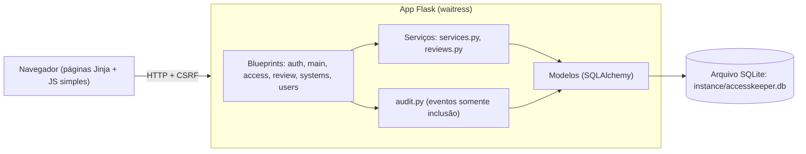

# AccessKeeper

Português · [English](README.md)

[](https://github.com/Vitorfab/AccessKeeper/actions/workflows/ci.yml)
[](https://github.com/Vitorfab/AccessKeeper/actions/workflows/codeql.yml)
[](LICENSE)

Um pequeno app web onde administradores de identidade **registram manualmente acessos privilegiados temporários que já concederam**, acompanham o vencimento e fazem campanhas periódicas de revisão.

> **Projeto de demonstração, não use em produção.** O AccessKeeper apenas registra e lembra. Ele não revoga nada no Entra ID, no FortiGate nem em qualquer outro sistema, e nunca deve ser usado para guardar senhas ou segredos.

## O que é

Exemplos de registro: uma função do Entra ID dada a uma conta existente, um convidado chamado para administrar um domínio por algumas semanas, direitos temporários de admin no FortiGate por três semanas. Alguém precisa lembrar de retirar esses acessos. O AccessKeeper mantém a lista, mostra o que está para vencer e transforma a revisão dos acessos expirados numa rotina visível e auditável.

Não há fluxo de solicitação e aprovação, integração com Microsoft Graph, SSO ou serviço externo, nem e-mail. Os alertas são visuais, no painel.

## Funcionalidades

- **Registro de acessos**: nome, e-mail, empresa, interno/externo, tipo de acesso, sistema/alvo (escolhido num catálogo), descrição, justificativa, quem autorizou, chamado (opcional), data e hora de início e fim, observações. Texto livre com autocompletar a partir do que já foi cadastrado.
- **Criticidade** (Standard, High ou Critical), escolhida por quem registra o acesso. Aparece como selo, pode ser filtrada e ordenada, entra no CSV, pode definir o escopo de uma campanha de revisão, e o painel conta os acessos High e Critical em andamento.
- **Atalhos de duração** (4h, 8h, 24h, 7d, 14d, 30d, 90d) ou data de fim personalizada. Avisos (nunca bloqueiam) aparecem acima de 1 ano, para acessos Critical acima de 30 dias e para High acima de 90 dias (`CRITICAL_MAX_DAYS`, `HIGH_MAX_DAYS`).
- **Status automático**: Scheduled (início no futuro), Active, Expiring soon (14 dias por padrão) e Expired. **Closed** é definido à mão, com motivo, ou por uma remoção confirmada numa revisão.
- **Renovação** com motivo. Cada data de fim anterior fica no histórico.
- **Registros nunca são apagados.** Acessos fechados ficam somente leitura e não podem ser renovados. Para conceder o mesmo acesso de novo, use **Register again**, que abre o formulário de novo acesso já preenchido e cria um novo registro.
- **Catálogo de sistemas**: o campo System / target é uma lista (Firewall, Web application firewall, Cloud provider, Microsoft 365 etc.) que qualquer administrador pode ampliar ou desativar em **Systems**. Sistemas nunca são apagados. O tipo de acesso continua texto livre.
- **Fila de revisão**: acessos expirados ficam numa fila permanente até alguém registrar o que aconteceu.
- **Campanhas de revisão**: nome, data de início, prazo e escopo (status, interno/externo, criticidade, empresa, sistema). Os acessos que combinam são copiados para a campanha e cada um recebe um resultado: *Removal confirmed*, *Renewed* ou *Kept with justification*. O andamento (por exemplo 8 de 12) e o estado de atrasada aparecem na tela.
- **Revisão em lote**: marque vários itens pendentes de uma campanha e registre um resultado para todos. Cada item é conferido antes; se um falhar, nada muda e cada problema é listado. *Removal confirmed* pede uma tela de confirmação, porque não dá para desfazer.
- **Relatório da campanha**: uma página para imprimir e um CSV com escopo, datas, totais por resultado e cada item com resultado, justificativa, revisor e data. Disponível para administradores e viewers.
- **Histórico de edição**: cada edição guarda o valor anterior e o novo de cada campo alterado, com quem e quando. Não pode ser alterado nem apagado.
- **Expiring summary**: uma página para imprimir com os acessos que terminam em breve e os expirados ainda sem revisão. Disponível para administradores e viewers.
- **Archive**: acessos fechados, fora da lista principal mas sempre pesquisáveis.
- **Logout automático após 5 minutos parado** (configurável). Um aviso aparece 30 segundos antes: mexa o mouse, clique ou digite para continuar logado.
- **Audit log** (só admin): somente inclusão, com filtros e exportação CSV. Os eventos novos são selados numa **cadeia de hash**, e a tela **Verify integrity** a confere.
- **Usuários e perfis**: `admin` e `viewer` (somente leitura), mais um administrador **master** protegido.
- **Exportação CSV** dos acessos e da auditoria, protegida contra injeção de fórmulas em planilhas.
- Tema escuro, todos os arquivos locais (sem CDN, sem rastreamento), funciona offline.

## Capturas de tela

_Adicione suas capturas aqui._

## Arquitetura



## Rodar no Windows (recomendado)

1. Instale o Python 3.12 ou mais novo em <https://www.python.org/downloads/> e marque **Add python.exe to PATH**.
2. Baixe ou clone o projeto e abra a pasta.
3. Dê dois cliques em **`run.bat`**.

Na primeira execução ele cria o ambiente virtual, instala as dependências, gera uma `SECRET_KEY` aleatória no `.env`, inicia o app e abre o navegador em <http://127.0.0.1:5000>. A primeira tela pede para criar o **administrador master**. Não existe usuário nem senha padrão.

Para parar o app, feche a janela ou pressione `Ctrl+C`.

## Rodar manualmente

```bash
python -m venv .venv
.venv\Scripts\activate          # Linux/macOS: source .venv/bin/activate
pip install -r requirements.txt
python init_env.py               # cria o .env com uma SECRET_KEY aleatória
python wsgi.py
```

## Rodar com Docker (opcional)

```bash
python init_env.py               # ou crie o .env à mão com SECRET_KEY=<valor longo e aleatório>
docker compose up --build
```

O app escuta apenas em `127.0.0.1:5000`. Os dados ficam no volume `accesskeeper-data`. Para redefinir a senha do master dentro do contêiner:

```bash
docker compose exec accesskeeper python reset_master.py
```

## Configuração (`.env`)

Copie `.env.example` para `.env` (o `run.bat` faz isso por você). As principais opções:

| Variável | Padrão | Significado |
|---|---|---|
| `SECRET_KEY` | gerada | Obrigatória. Nunca envie o `.env` ao Git. |
| `TIMEZONE` | `America/Sao_Paulo` | Fuso de exibição. Os dados são sempre guardados em UTC. |
| `EXPIRING_DAYS` | `14` | Janela de "Expiring soon". |
| `CRITICAL_MAX_DAYS` / `HIGH_MAX_DAYS` | `30` / `90` | Acessos Critical ou High mais longos mostram um aviso (nunca um bloqueio). |
| `AUDIT_HASH_KEY` | vazia | Chave separada opcional (32+ caracteres) para a cadeia de hash do audit log. Vazia significa derivar da `SECRET_KEY`. |
| `CSV_DELIMITER` | `,` | Use `;` se o Excel colocar cada linha numa coluna só. |
| `MIN_PASSWORD_LENGTH` | `12` | Tamanho mínimo da senha. |
| `MAX_LOGIN_ATTEMPTS` / `LOCKOUT_MINUTES` | `5` / `15` | Bloqueio de login. |
| `IDLE_TIMEOUT_MINUTES` | `5` | Desconecta após esses minutos sem atividade. |
| `COOKIE_SECURE` | `false` | Use `true` apenas atrás de HTTPS. |

## Usuários, perfis e o administrador master

- **viewer**: lê tudo, menos o audit log e os usuários. Não cria, edita, renova, encerra nem revisa.
- **admin**: acesso total ao registro e às revisões. Cria e gerencia **viewers**.
- **master**: o primeiro administrador, criado na tela de setup. Só o master cria administradores, muda o perfil de administradores, ou os desativa e redefine a senha deles. Ninguém rebaixa, desativa ou redefine a senha do master pela tela, e toda tentativa fica no audit log como `user.action_denied`.

Se a senha do master for perdida, execute `reset_master.bat` (ou `python reset_master.py`) **na máquina onde o app roda**. Ele pede a nova senha no terminal, desbloqueia a conta e registra o evento. Quem tem acesso à máquina já controla o arquivo do banco, então isso não abre nenhuma brecha nova.

## Como funcionam as revisões

- Acessos expirados aparecem na **fila de revisão** até serem revisados. Renovar o acesso também o tira da fila. Na fila, *Kept with justification* deixa o acesso na lista principal como uma exceção expirada.
- Em uma **campanha**, registre um resultado por item:
  - *Removal confirmed*: você conferiu que o acesso não existe mais. O registro é marcado como **Closed** automaticamente (vigente ou expirado), fica somente leitura e sai da fila e das campanhas futuras.
  - *Renewed*: renove o acesso primeiro e depois registre o resultado.
  - *Kept with justification*: a justificativa é obrigatória.
- Um resultado registrado é definitivo (também garantido por um gatilho no banco).
- Uma campanha pode ser encerrada a qualquer momento, mesmo com itens pendentes; o audit log guarda quantos foram revisados.

## Integridade do audit log

Cada novo evento de auditoria guarda o hash do evento anterior e o seu próprio hash: HMAC-SHA256 sobre os dados do evento e o hash anterior, com uma chave derivada (HKDF) da `SECRET_KEY`, ou da `AUDIT_HASH_KEY` se você definir uma. Alterar, remover ou inserir um evento quebra a cadeia.

- Abra **Audit log → Verify integrity** e clique em **Verify integrity**. Ele percorre a cadeia inteira e responde OK ou aponta o primeiro evento quebrado. Cada verificação fica registrada como `audit.integrity_checked`.
- Os eventos gravados **antes** da cadeia existir (versões antigas) nunca são reescritos. Ao atualizar, o app grava um evento inicial com a contagem deles e uma impressão digital SHA-256, então alterá-los depois ainda é detectado. Eles aparecem como "before the chain".
- A tela mostra o **topo da cadeia** (o último hash, com o número e o horário do evento). Copie esse valor para fora do app de vez em quando, por exemplo num chamado ou e-mail.
- **Guarde o `.env` junto com o backup do banco.** A chave da cadeia vem dele. Se a `SECRET_KEY` (ou a `AUDIT_HASH_KEY`) mudar, a verificação diz que não consegue verificar, em vez de acusar adulteração.
- O CSV do audit log inclui o hash anterior e o hash de cada evento.
- **Verificar sem o app:** `verify_audit.bat` (ou `python verify_audit.py`) confere o arquivo do banco diretamente, só leitura, usando apenas a biblioteca padrão do Python. Ele termina com 0 (íntegro), 1 (adulteração encontrada) ou 2 (não foi possível verificar), então também serve em tarefas agendadas. Use `--top <hash>` para comparar com o topo da cadeia que você copiou antes, e `--db <arquivo>` para outro banco. No Docker: `docker compose exec accesskeeper python verify_audit.py`.
- O painel lembra os administradores quando o log não é verificado há `INTEGRITY_REMINDER_DAYS` dias (padrão 30, `0` desliga).

## Backup do banco

O AccessKeeper usa um único arquivo SQLite: `instance/accesskeeper.db` (no Docker, dentro do volume `accesskeeper-data`). Para fazer backup, pare o app e copie esse arquivo para um lugar seguro, **junto com o seu `.env`**. Para restaurar, pare o app e coloque os dois arquivos de volta. Trate o backup como sensível: ele contém o registro de acessos e o audit log.

## Atualizando de uma versão anterior

Substitua os arquivos do projeto e mantenha a pasta `instance/` e o `.env`. Na primeira execução o app cria sozinho as tabelas e colunas novas e mantém os seus dados. Da 3.2 para a 3.3: uma tabela do histórico de edição é adicionada; nada mais muda. Da 3.1 para a 3.2: todo acesso existente vira **Standard** e a cadeia de hash do audit log começa (um evento inicial registra quantos eventos antigos existem e a impressão digital deles). Você não precisa apagar nem mudar nada. Se quiser, adicione `CRITICAL_MAX_DAYS`, `HIGH_MAX_DAYS` e `AUDIT_HASH_KEY` ao seu `.env`; os padrões funcionam. Atualizações anteriores (3.0 para 3.1) também montaram o catálogo de sistemas e fecharam os acessos já revisados como removidos. A configuração antiga `SESSION_MINUTES` não é mais usada: `IDLE_TIMEOUT_MINUTES=5` é o padrão.

## Testes

```bash
pip install -r requirements-dev.txt
python -m pytest
```

## Modelo de ameaças e limitações

**O que o app protege**

- Senhas com hash (scrypt). Sessões com cookies HttpOnly e SameSite=Lax, que expiram por inatividade.
- Proteção CSRF em todos os formulários, checagem de permissão no servidor em todas as rotas, consultas parametrizadas e saída escapada.
- Bloqueio de login e mensagem de erro genérica, para não revelar quais contas existem.
- Logout por inatividade: o servidor deixa de aceitar a sessão cerca de 20 segundos após o limite, e o navegador desconecta exatamente no limite. O aviso é uma conveniência, não um controle de segurança.
- O nome digitado numa falha de login **nunca** é gravado no audit log, porque às vezes a pessoa digita a senha nesse campo. O log guarda `anonymous`, o motivo e o IP.
- Content Security Policy sem fontes externas, além de `X-Content-Type-Options`, `X-Frame-Options`, `Referrer-Policy` e cabeçalhos relacionados.
- Os CSVs neutralizam células que começam com `=`, `+`, `-` ou `@`.
- O audit log, o histórico de renovações e os resultados de revisão registrados não podem ser editados nem apagados pelo app, e gatilhos do SQLite bloqueiam isso também no banco.
- O audit log também é selado numa cadeia de hash com chave, então alterações feitas direto no banco são detectadas pelo **Verify integrity**.

**O que ele não protege**

- É uma **demonstração local, em uma única máquina**. Não tem TLS por si só nem suporte a várias instâncias. Não o exponha em rede.
- Ele **não revoga nada** em nenhum sistema real. Alguém precisa fazer isso.
- Quem tem acesso à máquina, ao `.env` ou ao arquivo do banco tem controle total. O banco não é criptografado.
- Campos de texto livre ainda podem receber um segredo se alguém digitar. As telas avisam "Do not store passwords or secrets", mas o app não consegue detectar isso.
- Não há autenticação em dois fatores nem SSO.
- Até o primeiro administrador ser criado, a página de setup fica aberta para quem chegar primeiro ao app. Crie o administrador logo após a primeira execução e mantenha o app em `127.0.0.1`.
- O bloqueio de login é por conta, então alguém pode bloquear um usuário de propósito por alguns minutos.
- O audit log resiste a adulteração pelo app, mas não é à prova de adulteração: quem acessa o banco diretamente pode remover os gatilhos. A cadeia de hash detecta essas alterações **a menos que a pessoa também tenha a chave**: quem tem o banco e a `SECRET_KEY` (ou a `AUDIT_HASH_KEY`) consegue recalcular a cadeia inteira.
- A verificação sozinha não percebe que os **últimos** eventos foram apagados junto com o topo da cadeia. Copie o hash do topo para fora do app de vez em quando: uma verificação futura que não bata com ele revela um corte ou uma cadeia refeita.
- Se a chave da cadeia for perdida ou trocada, o log continua funcionando, mas a integridade dele não pode mais ser verificada.

## Estrutura do projeto

```
accesskeeper/
  __init__.py        fábrica do app, cabeçalhos de segurança, páginas de erro
  config.py          configurações vindas do .env
  models.py          tabelas, status, gatilhos do banco
  services.py        filtros, consultas de status, geração de CSV
  reviews.py         regras da fila, das campanhas, da revisão em lote e do relatório
  migrations.py      ajustes na inicialização (colunas novas, início da cadeia de hash, catálogo de sistemas, fechar removidos)
  audit.py           registro de eventos somente inclusão
  integrity.py       cadeia de hash do audit log: selagem, derivação da chave, verificação
  forms.py           validação
  blueprints/        auth, main, access, review, systems, users
  templates/ static/ páginas Jinja, CSS e JS locais
tests/               testes pytest
run.bat              início com um clique no Windows
reset_master.py      recuperação local da senha do master
verify_audit.py      verificador independente da cadeia do audit log (só leitura)
Dockerfile, docker-compose.yml
```

## Roadmap

Ideias ainda não construídas, em ordem aproximada de prioridade:

- Autenticação em dois fatores (TOTP) opcional para administradores.

## Segurança

Veja o [SECURITY.md](SECURITY.md) para reportar uma vulnerabilidade de forma privada.

## Licença

MIT. Veja [LICENSE](LICENSE).
